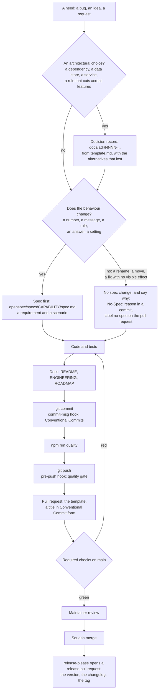

# Contributing

Thank you for helping with Shelf SDLC Agents. This page is the map: how a change
goes from a need to a release, what is checked and where, and what a commit
looks like. People and coding agents follow the same path (`AGENTS.md` holds the
short rules for agents).

Everyone taking part follows the [code of conduct](CODE_OF_CONDUCT.md).

## What helps most

<!-- List, in order, the contributions that help most: bug reports with a reproduction,
     docs, tests, a good first issue, data, translations... -->

1. A bug report with the steps to reproduce it (use the issue template).
2. A fix or a feature that follows the path below.
3. Documentation and examples.

## Setup

```bash
npm install
sh scripts/setup-hooks.sh   # once per clone: the git hooks
npm run quality             # the gate: it must pass before you push
```

## Workflow

The path every change follows, from the need to the release. `docs/EVOLVING.md`
explains each step; this page is the map.



### What do I do for my change?

| Your change                                                  | Do                                                                              |
| ------------------------------------------------------------ | ------------------------------------------------------------------------------- |
| An architectural choice                                      | A decision record in `docs/adr/`, committed first.                              |
| New behaviour, or a changed number, message, rule or setting | Edit the spec of the capability: a requirement and a scenario. Same pull request, committed first. |
| A new capability                                             | A new folder under `openspec/specs/`, a line in `openspec/README.md`, an entry in `openspec/code-map.json`. |
| A new source file                                            | Add it to `openspec/code-map.json`, so a change to it is tied to its spec.      |
| A rename, a move, formatting, a fix with no visible effect   | No spec change. A `No-Spec: <reason>` line in a commit and the `no-spec` label on the pull request. |
| A bug fix                                                    | A test that fails first, then the fix.                                          |
| Docs only                                                    | Nothing more to do.                                                             |

Two things are **not** a spec change: a change to the docs, and a spec edit that only moves whitespace. Do not reach for
`no-spec` when a test needed a new case or a number or a message changed: the review warns about it, and the reviewer reads
your reason. When unsure, update the spec.

### What is checked, where, and can it be skipped

| When         | What runs                                                                | Skippable?                                              |
| ------------ | ------------------------------------------------------------------------ | ------------------------------------------------------- |
| `git commit` | commit-msg: Conventional Commits. | `--no-verify`, or no hooks installed yet                |
| `git push`   | pre-push: `npm run quality` and the spec review. | `--no-verify`, `SKIP_PRE_PUSH=1`, or no hooks installed |
| Pull request | CI: the quality gate, the PR title, the spec review of the diff, CodeQL. | **No.** Required checks on `main`; only an administrator can merge past them. |
| Merge        | GitHub merges when the required checks are green. A person reads the pull request. | Administrators                                |

A git hook is a convenience on one machine: it can be skipped, and a fresh clone has none until
`sh scripts/setup-hooks.sh`. The pull-request checks cannot be skipped, so they are the rule.

### In steps

1. Branch from `main`: `feat/...`, `fix/...`, `docs/...`, `chore/...`.
2. Decide as the chart shows: a decision record, a spec, or a reason for none.
3. Code with tests. Never let a test reach a paid or external service for real.
4. `npm run quality` must pass.
5. Commit with Conventional Commits, one concern per commit, in the order of the chart.
6. Open a pull request with the template filled in: the decision and spec, what was verified, what was not. The **PR
   title follows the commit convention too**: a squash merge turns it into the commit on `main`, which release
   automation reads. If the change has no behaviour change, add the `no-spec` label and give the reason in the
   description.

## Commits

Conventional Commits, enforced by the commit-msg hook and in CI:

```
<type>(<scope>): <subject>

<body: what and why, wrapped at 120 columns, optional>

<footer: BREAKING CHANGE: ..., Refs #12, optional>
```

### Types

| Type       | Use for                                          | Release effect                 |
| ---------- | ------------------------------------------------ | ------------------------------ |
| `feat`     | A capability users did not have before           | minor version                  |
| `fix`      | Wrong behaviour corrected                        | patch version                  |
| `perf`     | Same behaviour, faster or cheaper                | patch version                  |
| `refactor` | Code change with no behaviour change             | none                           |
| `docs`     | README, docs, decision records, comments         | none (listed in the changelog) |
| `test`     | Tests only                                       | none                           |
| `build`    | Dependencies, tooling, build scripts             | none (listed in the changelog) |
| `ci`       | CI workflows, Dependabot, release automation     | none                           |
| `chore`    | Housekeeping that fits nowhere else              | none                           |
| `style`    | Formatting, no logic change                      | none                           |
| `revert`   | Reverts a previous commit; the subject names it  | depends on what is reverted    |

A breaking change adds `!` after the scope, `feat(api)!: ...`, and a `BREAKING CHANGE:` footer explaining the migration.

### Scopes

Lower-case, kebab-case, the area touched, for example: api, cli, core, docs, deps, release. A scope is optional for changes that span the
project (`docs: ...`, `build: ...`).

### Subject and body

- Imperative, present tense: "add", "fix", "remove", not "added" or "adds".
- No trailing period, at most 100 characters for the whole header.
- A body when the why is not obvious from the diff: what changed, why, what was verified. Reference issues in the footer:
  `Refs #12`, `Closes #12`.
- One concern per commit. A pull request with a feature, its tests and its docs is three commits, or one `feat` commit
  when they are inseparable.

### Examples

```
feat(api): accept a time zone on every request
fix(parser): reject a negative length instead of wrapping
perf(index): skip unchanged files on reload
refactor(core): share the validation between the CLI and the server
docs(adr): record why the cache is a single file
test(parser): cover the empty input
build(deps): bump the HTTP client
ci: run the tests on two runtime versions
chore: remove scratch exports
revert: "feat(api): accept a time zone on every request"
```
No attribution trailers or generated-by footers in commits or pull requests.

## Licence of contributions

Contributions are accepted under the project's MIT licence; by opening a pull request you agree to it.

## Releases

Release automation (release-please) opens and maintains a release pull request on `main` with the changelog and the
version bump. Merging it tags the release and publishes the release notes.

## Code conventions

<!-- Keep in step with AGENTS.md: the conventions a newcomer would get wrong. -->
