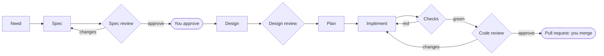

# shelf-sdlc

<!-- badges:start -->
[](https://github.com/bhoudebert/shelf-sdlc-agents/actions/workflows/ci.yml) [](https://github.com/bhoudebert/shelf-sdlc-agents/actions/workflows/codeql.yml) [](https://github.com/bhoudebert/shelf-sdlc-agents/actions/workflows/specs.yml) [](https://github.com/bhoudebert/shelf-sdlc-agents/actions/workflows/pages.yml)
[](https://github.com/bhoudebert/shelf-sdlc-agents/releases) [](https://github.com/bhoudebert/shelf-sdlc-agents/blob/main/LICENSE) [](https://github.com/bhoudebert/shelf-sdlc-agents/commits/main) [](https://github.com/bhoudebert/shelf-sdlc-agents) [](https://github.com/bhoudebert/shelf-sdlc-agents/issues) [](https://github.com/bhoudebert/shelf-sdlc-agents/pulls)
[](https://www.python.org/) [](https://temporal.io/) [](https://fastapi.tiangolo.com/) [](https://docs.docker.com/compose/)
[-D7FF64?logo=ruff&logoColor=black)](https://docs.astral.sh/ruff/) [](https://github.com/microsoft/pyright) [](https://import-linter.readthedocs.io/) [](https://github.com/bhoudebert/shelf-sdlc-agents/tree/main/openspec) [](https://conventionalcommits.org) [](https://github.com/bhoudebert/shelf-sdlc-agents/blob/main/CONTRIBUTING.md)
<!-- badges:end -->

A self-hosted software factory. Sign in with GitHub, pick a repository, and start agent work from the web UI at any step
of the lifecycle: a need, a spec, a design, a plan, code to write, or "review my pull request". Every step is a durable
Temporal workflow, every loop is bounded, and a person decides at the gates, from the UI or on the pull request.



One GitHub App does sign-in, repository access and the agents' identity. Agents run on the Claude Agent SDK, in a fresh
clone per step, with the tools of their role and a one-hour token. Reviewers are a different model from producers.

## Status

**Early development, not yet verified end to end on real agents.** Built and tested: the pure pipeline core, access rules and
roles, the Temporal workflow (on a real server, with history replay), the GitHub App adapter (sign-in, repositories,
installation tokens, pull requests, one-click registration), the step runner (fresh clone, role prompts, verdicts, checks),
the web interface and the Docker Compose deployment (booted on real Docker). Not yet done: a full run with a real model on a
real repository, per-repository settings edited in the UI, continuing a workflow past very long waits, other agent backends.
See the [roadmap](ROADMAP.md).

## Getting started

### Run it

You need Docker, a public HTTPS address (any reverse proxy or tunnel in front of port 8080; none is bundled), and a model
credential (an Anthropic API key or a Claude subscription token).

```bash
git clone https://github.com/bhoudebert/shelf-sdlc-agents && cd shelf-sdlc-agents
sh deploy/install.sh https://shelf.example.org
```

Open that address. The first visit registers the GitHub App in one click and shows what to paste into `deploy/.env`; run
the script again, install the App on your repositories, and sign in. [The full guide](https://bhoudebert.github.io/shelf-sdlc-agents/docs/getting-started.html)
covers every setting. Kubernetes is up to you: `deploy/compose.yml` lists every service, variable and volume it takes.

### Develop

```bash
nix develop                      # or: install uv and Python 3.13
uv sync --frozen
uv run pytest                    # unit, property and Temporal tests
```

## Documentation

- [Contributing](CONTRIBUTING.md): the workflow from idea to release, commits, checks.
- [Engineering](docs/ENGINEERING.md): how it is built.
- [How it evolves](docs/EVOLVING.md): the path every change follows.
- [Decision records](docs/adr/README.md): why it is shaped this way.
- [Roadmap](ROADMAP.md)
- [Security](SECURITY.md) · [Support](SUPPORT.md) · [Code of conduct](CODE_OF_CONDUCT.md)

## Working with coding agents

`AGENTS.md` is the single source of the rules for Claude Code, Codex, Gemini CLI, GitHub Copilot and other agents;
`CLAUDE.md`, `GEMINI.md` and `.github/copilot-instructions.md` point to it.

## Licence

Apache-2.0, see [LICENSE](LICENSE).
