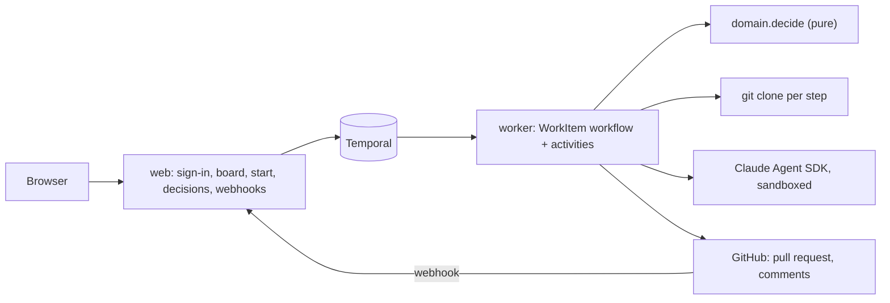

# Engineering

How Shelf SDLC Agents is built. Keep this page true: update it in the same pull request as an architectural change.

## Overview

A person signs in with GitHub (one GitHub App), starts work from the web interface, and the **web** service asks Temporal to
run a `WorkItem` workflow. The **worker** runs that workflow and its activities: a fresh git clone per step, the agent role of
the phase on the Claude Agent SDK, the project's checks, and the pull request on GitHub. The workflow decides nothing itself:
it feeds events to the pure `decide` function of the domain and executes the commands it returns. People answer at gates in
the interface or with `/shelf` comments on the pull request; GitHub webhooks (server mode) or a slowing durable poll (local
mode) tell waiting work what happened.



Layers, from the inside: `domain` (pure, standard library only), `ports` (protocols), `application` (use cases),
`adapters` (Temporal, GitHub, git, Claude, config, web), `entrypoints` (the composition roots `shelf-web` and
`shelf-worker`).

## Layout

```
src/shelf/domain        pipeline, policy, work-item state machine, roles, commands, access: pure
src/shelf/ports         the protocols the application needs
src/shelf/application   use cases: sign in, start work, decide, board, run a step
src/shelf/adapters      temporal, github_app, git, claude_agent, config, web
src/shelf/entrypoints   settings, wiring, the web and worker programs, first-run setup
src/shelf/prompts       one system prompt per agent role
warden                  the Rust guard: a policy engine wired into each agent's hooks (decision 0014), its own binary and release
openspec/specs          what the system does, as requirements with scenarios
tests                   mirrors src; Temporal tests run on a real dev server
deploy                  compose.yml, .env.example, shelf.toml.example, install.sh (the access list lives in config/shelf.toml)
site                    the public site (GitHub Pages)
docs                    this page, the workflow (EVOLVING.md), decision records (adr/)
```

## Key decisions

The reasons live in [`docs/adr/`](adr/README.md). The ones that shape everything else:

- [0001](adr/0001-record-architecture-decisions.md) Record architecture decisions
- [0002](adr/0002-conventional-commits-and-automated-releases.md) Conventional Commits and automated releases
- [0003](adr/0003-one-agent-instruction-file.md) One agent instruction file for every agent
- [0004](adr/0004-specs-are-checked-in-ci.md) Specs are checked in CI
- [0006](adr/0006-python-with-a-pure-core-and-hexagonal-layers.md) Python, a pure functional core, hexagonal layers
- [0007](adr/0007-a-python-only-web-ui.md) A Python-only web interface

## Rules the code enforces

| Rule | Enforced by |
| --- | --- |
| Dependencies point inwards; the domain imports the standard library only; adapters do not know each other | `import-linter` contracts in `pyproject.toml`, in the quality gate |
| The pipeline logic is a pure function | no I/O is importable in `domain`; property tests over random event sequences (`tests/domain/test_work.py`) |
| A finished work item never changes; loops are bounded | `decide` ignores events once finished; `max_rounds` in the policy; property tests |
| A workflow change does not break running work | history replay test on a real Temporal server |
| People decide only with a closed list of commands, never interpreted by a model | `shelf.domain.commands` matches a fixed word list; only trusted commenters count |
| Only people with a role decide where roles are set | `may_decide` in `shelf.domain.config`, checked in `decide_work` |
| Agents only read or write their own clone, with their role's tools, sandboxed | `ClaudeAgentOptions` built in `adapters/claude_agent`, tested; the sandbox is on |
| Tokens are minted per use and never stored or logged | `entrypoints/wiring.token_source`; git errors redact the token (tested) |
| An unconfigured instance is not silently open | a warning is logged; the setup mode serves no sign-in |
| Behaviour changes with its spec | the "Spec or docs with code" required check |

## Quality gate

`uv run ruff check . && uv run ruff format --check . && uv run pyright && uv run lint-imports && uv run pytest` runs everything CI runs. The pull request checks are required on `main`.

## External services

- **GitHub** (REST, as the App and as the signed-in person): no caching; a failed call fails the activity, which Temporal retries
  with the policy of the call (steps twice, GitHub writes five times). A step that still fails becomes a wait for a person.
- **The model** (Claude Agent SDK, through the credential the operator sets): bounded per step by turns and optionally dollars;
  a failure is a failed step.
- **Temporal**: the bundled dev server for small teams, or your own cluster. Workflows survive restarts of web and worker.
- **git over HTTPS** to GitHub with an installation token, one fresh clone per step, removed afterwards.
