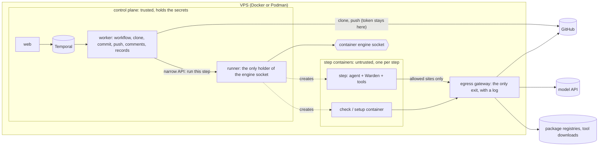
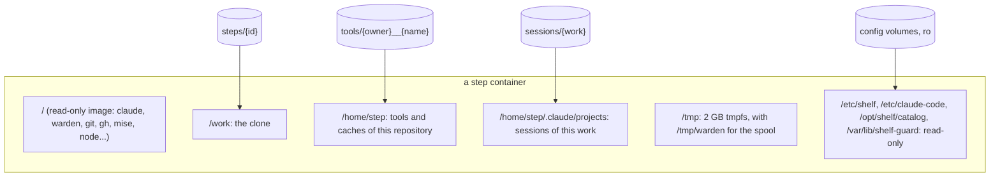
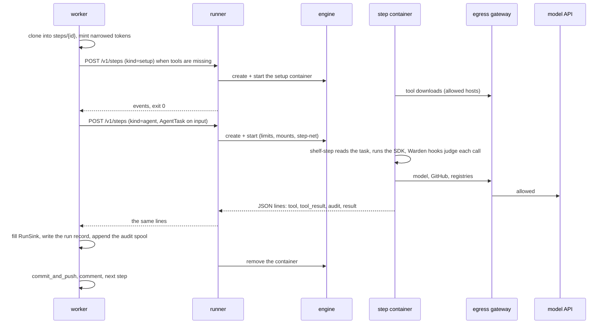
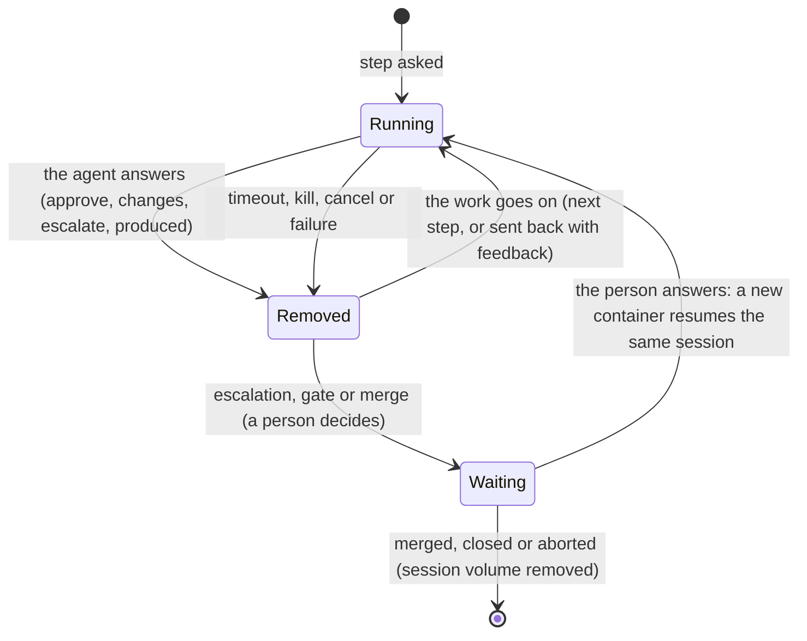

# Isolated step environments: technical design

Status: proposed, with [decision 0019](../adr/0019-run-each-step-in-an-isolated-environment.md). Nothing here is built.
Written 2026-11-18 against `main` after protocol 11.

The rule that shapes everything: **it must do everything the sandbox mode does today, and more.** Section 3 is the checklist
that decides whether the mode may become the default.

## 1. In plain words

Today the worker runs the agent itself, in a bubblewrap sandbox inside the worker container. In the new mode the worker asks
a **runner** to start a **new container** for the step. The worker still clones the repository, and still commits, pushes and
comments. The container gets the clone, the tools, the model credential and a network that only reaches what is allowed. The
agent works in it exactly as it does now, and prints what it does as a stream of lines the worker already knows how to read.
When the step ends the container is removed.



## 2. What exists today that must survive

The inventory below is read from the code, not from memory.

| Area | Today |
| - | - |
| Agent process | Claude Agent SDK call in the worker process, `cwd` = a temp clone, sandbox on (nested mode), `acceptEdits`, per-role tool list, turn and budget limits |
| Sandbox | bubblewrap: the clone and `$TMPDIR` writable, the rest read-only, home unreadable placeholders, network through a built-in proxy with an allowed-domains list |
| Network list | defaults + `SHELF_ALLOWED_DOMAINS` + sites added on the admin page, read on every step |
| Web tools | WebFetch/WebSearch for every agent unless `SHELF_WEB=off` |
| Warden | hooks on every tool call: policy layers, redaction, hash-chained audit log in a volume shared with the web service; overlay rules written by the admin page |
| Catalog | skills and plugins synced to a volume, managed policy that enables them and the Warden hook, read-only |
| Repository agent files | `CLAUDE.md`, skills, commands loaded; the repository's hooks and MCP servers never loaded |
| Tools | `mise use --global` of a sanitised declaration by the worker into `/cache/home/<owner>__<name>`, PATH shims, or a Nix flake environment from a read-only store |
| Checks | the repository's `checks` run by the worker in a shell, scrubbed environment, no sandbox |
| Credentials | model credential in the agent's environment; `GH_TOKEN` (App installation token, one hour) for the implementer only; the worker's own secrets blanked |
| Sessions | an agent that is sent back continues its earlier session (protocol 9); fall back to a fresh run when it cannot |
| Records | tool events, usage, errors, denials per run, written by the worker from the SDK message stream; the Download file is built from them |
| Live tests | the agent may start a database binary or the built jar as plain processes in the sandbox and reach them on localhost |
| Concurrency | `docker compose up --scale worker=N`; steps of different works at the same time |
| Failure | a step times out at 45 minutes with a heartbeat; Temporal retries once |

## 3. Parity and gain, capability by capability

"Same" means behaviour a person cannot tell apart. Every row must be tested on a real repository before the default changes.

| Capability | In a container | Verdict |
| - | - | - |
| Filesystem limits | the container's own filesystem is the boundary; root is read-only; only the clone, the session store, the tool home and a small `/tmp` are writable | same, stronger (nothing else of the worker is visible) |
| Writable home, real caches | a home inside the container, with the repository's tool and cache volume mounted | better (no read-only home, no placeholder files, the Prettier workaround goes) |
| Network allow-list | the container has no route except the gateway; same lists, read from the same volume each request | same |
| Tools that ignore `HTTPS_PROXY` (JVM, Gradle, some CLIs) | transparent gateway (section 8) so no client setting is needed | better (today needs tool-specific settings) |
| Web tools | go through the gateway like everything else | same |
| Warden decisions, redaction | the same binary, the same policy files (operator file, overlay, repository file), mounted read-only | same |
| Warden audit chain | each step writes its own records to a spool; the worker appends them to the chain, one writer | same log, safer (a step cannot rewrite the chain) |
| Managed policy, catalog, skill bundles | volumes mounted read-only at the same paths | same |
| Repository hooks and MCP never loaded | same `disableAllHooks`, `strict_mcp_config` and setting sources | same |
| Tools by mise | setup container installs into the repository's tool volume with no model credential; agents may also install on demand because the network allows the tool hosts | better (any backend, including plugin-based, because it is boxed) |
| Nix flake environment | the store volume mounted read-only | same |
| Checks | run in a container of the same kind as the step, no model credential | same, stronger (today they run in the worker) |
| Credentials | model credential in the container (later: a per-step token, section 9); `GH_TOKEN` narrowed to the one repository | same, narrower |
| Sessions | the session files live in a volume per work, mounted in every step of that work; the session id stays in the workflow as today | same; the one new requirement is that the files outlive the container (section 11) |
| Records and Download | the container streams events; the worker fills the same `RunSink` | same |
| Live processes on localhost | plain processes in the container | same |
| A real Postgres, browsers, a front end | the tool volume gives a conda `postgres`; an image variant carries browsers and their libraries | better |
| Docker or Testcontainers in tests | only with an operator-provided runtime (sysbox or rootless Podman) that makes a private daemon safe; off by default | new, opt-in |
| Scaling | one container per step, any number of workers | same |
| Time, CPU, memory, processes, disk | enforced by the engine per step | new |
| Failure and cancel | the runner kills and removes the container; a reaper removes strays | same, with a hard kill |

## 4. Components

| Component | Where | Trust | Job |
| - | - | - | - |
| `worker` | existing | trusted | the workflow and the activities; clones into the steps volume; commits and pushes; mints narrowed tokens; calls the runner; writes run records; appends audit spools |
| `runner` | new service, image target `runner` | trusted, tiny | holds the engine socket; accepts only one request shape (section 5); creates, streams, kills, removes; reaps strays |
| `shelf-step` image | new target in the same `Dockerfile` | untrusted when running | the Claude CLI and SDK, `warden`, git, `gh`, mise, node, rtk, ripgrep, an entrypoint `shelf-step`; no bubblewrap, no socat, no App key |
| `egress` gateway | new service | trusted | the only exit of the step network; allow-list, per-step identity by source address, log |
| `step-net` | engine network, `internal` | | no route out except the gateway |
| volumes | see section 6 | | steps, tools and caches, sessions, spool, read-only config |

The `runner` is the one new piece with real power. It is written in the same Python code base (`shelf.adapters.container`), with
no framework beyond the standard library and `httpx` over the socket, and tested against a fake engine.

## 5. The runner API

The worker reaches the runner on a unix socket in a volume only the worker and runner share; there is no TCP port.
The request has a fixed shape. There are no fields for mounts, capabilities, devices, ports, user, network, privileged mode or
raw engine options: **the runner builds the container specification itself.**

```json
POST /v1/steps
{
  "key": "wf-117eab59a243/implement/2",          // idempotent: asking again returns the same step
  "kind": "agent",                                 // agent | check | setup
  "image": "step",                                 // a name the operator mapped to an image, never a free reference
  "repo": "hid-ttt/starter-test-jdk27-spring4",    // selects the tool volume; checked against the steps volume
  "clone": "steps/wf-117eab59a243-5f3a",           // a sub-path of the steps volume, checked against ^steps/[a-z0-9-]+$
  "session": "work/wf-117eab59a243",               // optional sub-path of the sessions volume
  "mode": {"tools": "rw", "clone": "rw"},          // reviewers get "ro" tools
  "limits": {"cpus": 4, "memory_mb": 6144, "pids": 2048, "tmp_mb": 2048, "seconds": 2700},
  "env": {"ANTHROPIC_API_KEY": "...", "GH_TOKEN": "..."},   // keys matched against an allow-list of patterns
  "input": {"...": "the AgentTask, see section 7"}
}
→ 200 text/event-stream, one JSON object per line, ending with {"e":"exit","code":0}
GET    /v1/steps/{key}                             // state, exit code and times; also after the container is gone
GET    /v1/steps/{key}/events?cursor=N             // the same lines again from line N (re-attach)
DELETE /v1/steps/{key}                             // kill and remove
```

`GET` exists for a worker that restarted in the middle of a step (a Temporal retry): it asks for the same `key`, and gets
the running stream again from its cursor or the finished result, never a second container. The runner keeps the events and the
exit of a finished step for 24 hours, then forgets them.

What the runner always applies, whatever the request says:

- non-root user (uid 1000), `--read-only` root filesystem, `--cap-drop ALL`, `no-new-privileges`, the engine's **default** seccomp
  and AppArmor profiles (the worker no longer needs `unconfined`);
- no host path mounts: volumes only, by name and sub-path, with the mode the request names but never more than the operator's
  table allows for that `kind`;
- `step-net` as the only network, the gateway as DNS and route; no published ports; `--init`; labels for the reaper;
- every container and volume it creates carries labels (`shelf.step`, `shelf.expires`, `shelf.managed`). The expiry lives in the
  label, not in memory: at startup the runner lists what it owns, kills what expired, removes orphans and **fails to start** if the
  engine cannot be read. It only ever deletes things with its own label. One lock per step guards kill, expiry and removal;
  its state file is written to a temporary file and renamed;
- a mount source is checked before use: a sub-path is joined, normalised, resolved with `realpath` on both sides and must
  stay inside the volume root the runner owns; it never creates a directory itself, and an empty allow-list rejects everything;
- it refuses to start without a caller token, unless the operator set an explicit "insecure" variable (used by tests only);
- limits capped by the operator's maxima in `[isolation.limits]`; a wall-clock deadline slightly after the workflow's step timeout;
- an `env` key that does not match the allow-list (`ANTHROPIC_*`, `CLAUDE_CODE_*`, `GH_TOKEN`, `SHELF_STEP_*`, tool variables the
  setup defines) is refused with a clear message.

Operators may map more image names (a variant with browsers, one with a private Docker daemon behind a safe runtime) in
`shelf.toml`; a repository selects one by name in `.shelf/config.toml` and the operator's list caps what it may ask for.

## 6. Mounts and what a step can write



| Path | Backing | Agent step | Reviewer step | Check | Setup |
| - | - | - | - | - | - |
| `/work` (clone) | `steps/<id>` | rw | rw (it is a throw-away clone; the worker pushes only for producing roles) | rw | ro |
| `/home/step/.local/share/mise`, `.m2`, `.npm`, `.cache` | `tools/<repo>` | rw | **ro** | rw | rw |
| `/home/step/.claude/projects` | `sessions/<work>` | rw | rw | none | none |
| `/home/step/.claude/settings*`, `/etc/claude-code` | image and config volume | ro | ro | none | none |
| `/tmp` | tmpfs, sized | rw | rw | rw | rw |

A per-repository tool volume can be written by one work and read by the next. That is the same exposure as the worker's
per-repository home today; it is capped to the repository, and reviewers mount it read-only. Agent settings and hooks are never
in a writable place, which closes today's gap where a sandboxed run could be asked to write them.

The clone is created by the worker, with the token only in a header for that git command (as today). The clone holds no
credential, so mounting it hands the step nothing. The worker commits and pushes after the step; a step can neither push nor
reach the other clones.

## 7. One step, end to end



### The task on `input`

The worker serialises what `AgentTask` already holds: `role` (name, tools, the model and turn settings), `system_prompt`,
`prompt`, `resume`, `fallback_prompt`, `max_turns`, `max_budget_usd`, `model`, the web flag, the allowed sites it computed for
this step, and the bundle names bound to the role. `shelf-step` rebuilds the same `ClaudeAgentOptions` with the existing
`options_for` (`sandbox=False`: the container is the boundary). Prompts, roles and tools do not change.

### The event stream (container to worker)

One JSON object per line on stdout; anything else on stdout is a protocol error and the step fails loudly.

```text
{"e":"tool","id":"toolu_1","name":"Bash","summary":"mvn -q verify"}
{"e":"tool_result","id":"toolu_1","error":true,"note":"[ERROR] ... (first 240 chars, redacted)"}
{"e":"audit","n":17}                         // a Warden record was written to the spool
{"e":"result","is_error":false,"result":"<final text>","session":"...","usage":{...},
 "subtype":"success","stop_reason":"end_turn","terminal_reason":"","api_error_status":null,
 "errors":[],"denials":["Bash: curl http://..."]}
{"e":"exit","code":0}                        // written by the runner, not the step
```

Two more lines exist for the transport, not for the work. `{"e":"ping"}` every 3 seconds, so a proxy or an idle timer never
kills a long silent step (a Maven run can say nothing for minutes); the worker drops it. And the first line is
`{"e":"hello","v":1}`: the stream is versioned from the start, and the reader ignores any field or event kind it does not know,
because a new field that a strict reader rejected is how one real client of a similar tool crashed. `exit` carries a reason
when it is not a plain end: `{"e":"exit","code":-1,"reason":"timeout"}` (or `killed`, `oom`), so the workflow can tell a
timeout from a failure. A stream that ends without `exit` is a failed step, never a success; the worker then asks `GET` for the
truth. A `check` request names its command as an argument list (`argv`, no shell) unless the repository's declaration is a
shell line, in which case that is stated.

`summary` and `note` are computed in the container with the same domain functions (`tool_summary`, `result_note`, `redact`) so
the worker never receives a secret the record would have removed. The worker feeds these lines to the same `RunSink`
(`watch_run`/`note_result` become two small functions over events instead of SDK messages), so run records, the Download file
and the usage pie do not change.

## 8. Network

Principle: the step has **no route** except the gateway; a tool that ignores a proxy variable fails instead of leaking.

**Stage A, explicit proxy (same reach as today).** The gateway is an HTTP/CONNECT proxy on `step-net`. A step is identified by its
source address, which the runner assigns and registers with the gateway for the step's lifetime (no credential in the proxy URL,
which breaks some JVM clients). The environment carries `HTTPS_PROXY`, `HTTP_PROXY`, `NO_PROXY=localhost,127.0.0.1`, and
`JAVA_TOOL_OPTIONS` with the proxy host and port. The allow-list is evaluated per request from the same sources as today:
defaults, `SHELF_ALLOWED_DOMAINS`, `SHELF_GUARD_RULES_DIR` (read on every connection, so an admin's change applies at once).

**Stage B, transparent gateway (any client).** The step's DNS server is the gateway. For an allowed name it answers with the
gateway's own address; for anything else it answers `NXDOMAIN`. The gateway accepts TCP 80 and 443, reads the HTTP `Host` or the TLS SNI
(no decryption), checks it against the allow-list for the identified step, then connects to the real host itself. JVM, Gradle,
Go, Rust, `curl`, Playwright's downloader and `mise` all work with no setting. Non-HTTP protocols (a database on the internet,
SSH) have no path, which is the intent.

**Modes.** The operator sets the default, and a repository may choose a mode in `.shelf/config.toml` no looser than the operator's
cap:

| Mode | A host not on the list | Use |
| - | - | - |
| `strict` (default, today's behaviour) | refused, logged; the agent is told to say which host it needed | most repositories |
| `learn` | allowed, logged as "would have been refused", flagged on the admin page | a new repository whose needs are unknown: run it, then read the list and turn it into allowed sites |
| `ask` | refused; the step ends as "blocked: needs these hosts", the work waits, an administrator allows once, for this repository or for everyone, and the step runs again (a protocol bump; later stage) | repositories where nothing should leave without a person |

`learn` never opens non-HTTP traffic, private addresses or a denied host: those stay refused in every mode, as Warden decides
today.

Both stages write the same record per attempt: `{work, step, repo, host, port, allowed, bytes, at}`, to a volume the web service
reads. The admin page gets an "outbound" view and an **Allow this site** button on a refused host, reusing the rule kind that
exists today (`allow_site`). The `ask` mode is a later stage with its own protocol bump.

**How stage B enforces it** (the pattern of OpenSandbox's egress sidecar, see section 16). The gateway owns the step's network
namespace rules. Its firewall chain is `drop` by default and ordered: the gateway's own traffic, loopback, DNS to the gateway;
operator and Warden denials; established flows to learned addresses; allowed sets; then drop. When the gateway answers a DNS
query for an allowed name, it first writes the resolved addresses into a firewall set with a timeout (the record's TTL plus 60
seconds, between 60 and 360), and only then replies, so the address is open before the client can dial. Connections still open
renew their lease. DNS over TLS is always dropped; UDP and QUIC to port 443 are dropped so clients fall back to TCP, where the
SNI check applies. The gateway fails closed: if it cannot install its rules it exits, and the runner then refuses to start
steps. An address allowed for one name is **not** enough for another name on the same CDN address, because the SNI check still
decides. Operators also get floors that a repository cannot override: an always-deny list, an always-allow list (the model
API and GitHub), and a port cap, reloaded every minute. A wildcard `*.example.org` does not match `example.org` itself.

The gateway is a small Rust service, `warden-egress`, in the `warden/` workspace: it reuses the policy crate (decision 0014 already
said the egress would share Warden's policy), so a domain denied by Warden's rules is denied on the wire too, in every profile.

## 9. Credentials

| Secret | Where it lives | What the step gets |
| - | - | - |
| GitHub App private key | worker, mounted from `secrets/` | never |
| Installation token, push | worker, in a git header per command | never; the clone holds no credential |
| Installation token, `gh` for the implementer | minted per step, **narrowed to the work's repository**, read on Actions and checks only, one hour | in the environment of the implementer container only |
| Model credential | worker environment | stage 1: in the environment of the container, as today |
| Model credential, later | worker | stage 3: a **model gateway** on `step-net` forwards `/v1/messages` to the provider with the real credential; the step gets a per-step bearer token valid until the step ends, so a leaked token is useless after it |
| Session, webhook, App settings | worker, web | never (the runner refuses the variable names) |

The model gateway is a spike (section 13): the Claude CLI honours `ANTHROPIC_BASE_URL` with a token, but an OAuth credential
(`claude setup-token`) may require headers a plain forwarder must reproduce. If the spike fails, the credential stays in the
container, which is what 0012 accepted and what today does inside the sandbox.

## 10. Warden inside the container

Warden stays a hook of the Claude CLI, from the managed policy volume, with the same three policy layers. Two changes:

1. **Audit spool.** The hook writes records to `/tmp/warden/spool` (inside the step). `shelf-step` announces each batch as an
   `audit` event, and the worker appends the spool to the hash chain after the step (and on a short interval during long steps),
   so the chain has one writer and a step can add records but never rewrite the chain. This needs a `warden audit ingest <spool>`
   subcommand (Rust, its own pull request with tests for the chain across ingests).
2. **No `WARDEN_SESSION_DIR` special case** in `/tmp/claude-1000`: the session directory is `/tmp/warden`, owned by the step user.

The classifier, rules, redaction and the profile (`shelf`) do not change. The tests that pin them (`warden test`) run on both modes.

## 11. Tools, caches and sessions

- **Setup container.** The worker asks for a `kind=setup` step with no model credential and the tool volume mounted
  read-write. It runs `mise install` for the repository's declaration. Because it is boxed, it may run the full declaration
  (hooks, plugins, plugin-based backends such as asdf and vfox); the sanitiser of `mise_config.py` stays for `sandbox` mode only.
  It reports the same `ToolSetup` note the prompts use today.
- **On-demand installs.** Agents may run `mise use` themselves because the tool hosts are allowed and the volume is writable. The
  prompt note about tools changes from "the worker installed these" to "these are installed; install more with mise".
- **Nix.** The persistent store volume is mounted read-only at the same path.
- **Sessions.** Today the workflow keeps, per work and per agent (the role of the phase, so the spec writer, the spec reviewer,
  the implementer and the code reviewer each have their own), the id of the latest session, and the session's files live in the
  repository's home on the worker. A container is thrown away, so its files must not be: the session store is a volume per work
  (`sessions/{work}`), mounted into every step of that work at the place Claude Code keeps sessions. The id travels as it does now
  (`resume` in the task). Resuming from a different working directory works with the Claude Code in use (checked on 2.1.323),
  so the clone path need not be fixed, but it is fixed anyway (`/work`). The existing fall-back to a fresh run from the whole task
  stays for a session that cannot be continued. The volume is removed when the work ends (merged, closed or aborted) and by a
  retention sweep (30 days, like the run records).
- **Checks.** `workspace.run(command)` for the repository's `checks` becomes a `kind=check` container with the tool volume, no model
  credential and no `GH_TOKEN`. Same commands, same output tail, same `Verified` result.

### Waiting, escalation and resume

A container lives for one step and nothing else. **While a work waits for a person, nothing is running**: no container, no token, no
connection. A wait can last days at no cost; the only thing kept is the work's session volume and the clone on its branch.



- **Escalation** (a deadlock, a repeated point, a failed step) is an answer, not a pause: the agent has returned its text and the
  container is already gone when the person is asked. Agents never wait for a person inside a step.
- **The person answers** (resume, changes, approve): the workflow starts a new step, so the runner starts a new container. It
  mounts the same session volume and the same repository tool volume, and the agent continues the session of its role on this work
  with the person's note as the new message, as it does today.
- **A step that is killed or times out** (45 minutes, a worker restart, cancel): the runner removes its container; the clone and the
  session volume stay. Temporal retries the activity with the same `key`, which starts a fresh container that continues the
  session, or starts afresh if the session cannot be continued.
- **Network `ask` mode**: a refused host ends the step as "blocked: needs these hosts" (the container is removed), the work waits
  like any other gate, and an allow from the admin page starts the step again in a new container that resumes its session and is
  told which hosts are now allowed.
- **Nothing is kept warm** on purpose: a live container would hold a one-hour token and a network identity for a wait of unknown
  length. A warm pool for start-up speed, if the measured start cost asks for it, would hold empty containers, never a step's.

## 12. Operations

- **Compose.** `runner` and `egress` services, `step-net` (`internal: true`) plus an `egress-out` network for the gateway, volumes
  `steps`, `tools`, `sessions`, `spool`, `egress-log`. The worker loses `security_opt: [seccomp=unconfined, apparmor=unconfined]`
  and `SHELF_NESTED_SANDBOX` in container mode. Only the runner mounts the engine socket.
- **Engine.** Docker Engine 26 or later (volume sub-paths) or rootless Podman 5 with the compatible socket. `install.sh` and
  `shelf-doctor` check the version, `step-net` being internal, that a step really cannot reach a public address except through the
  gateway, and that the image pulls.
- **Reaping.** Containers carry labels `shelf.step=<key>` and `shelf.started=<time>`; the runner removes any past the maximum and
  any whose worker is gone. Temporal retries use the idempotent `key`: a retried activity re-attaches to the running container or
  starts a fresh one after the old one is killed.
- **Observability.** Run records gain `isolation`, `image`, `container_start_ms` and the limits that applied. The Download file
  shows them. The doctor prints the runner's version and the engine's.
- **Rollback.** `SHELF_ISOLATION=sandbox` returns to today's behaviour at the next step. Work already running is not affected: the
  mode is not part of the workflow's protocol, it is a deployment setting, and the domain does not know it.
- **Cost.** A start is expected to take one to two seconds, a first pull a few minutes; both are measured in stage 1, not assumed.

## 13. Threats, and what stops each

| Threat | Today | In a container |
| - | - | - |
| A hostile repository or a prompt-injected agent reads the App key | blocked by the sandbox's read limits and Warden | not mounted at all |
| It reads another work's clone or another repository | blocked by the sandbox | not visible |
| It steals the model credential | possible, it is in the environment | possible in stage 1; useless after the step in stage 3 |
| It opens a connection to a server of its own | blocked by the proxy list, but a tool that ignores the proxy can try | no route; DNS is filtered; log of every attempt |
| It rewrites agent settings or hooks | blocked by write limits and Warden | read-only mounts |
| It runs a fork bomb or fills the disk | not limited | pids, memory, CPU, tmpfs and time limits |
| It breaks out of the sandbox through a kernel bug | weaker nested sandbox with seccomp off | default seccomp and AppArmor, no capabilities, non-root; a stronger runtime (gVisor, sysbox, a microVM) is a runner setting |
| It poisons the tool cache of the repository | possible | possible; capped to the repository; reviewers mount read-only; the volume can be emptied from the admin page |
| It talks the runner into starting something privileged | not applicable | the API has no field for it |
| It uses an allowed host to carry data out (a gist, a registry) | possible | possible; logged; the narrowed token and the single credential keep what it can carry small |

The runner holds host root through the socket. That is the price of the design and the reason it is a separate, tiny, read-only
service with a fixed API and its own tests, not a library inside the worker.

## 14. Stages

Each stage is its own pull request, with its spec, tests and an update to this document's status.

| # | Stage | Done when |
| - | - | - |
| 0 | This design and decision 0019 accepted | merged; the proposal of 0012 closed as superseded |
| 1 | `shelf-step` entrypoint, the event protocol, `ContainerBackend` against a **fake runner**; `SHELF_ISOLATION` setting; run record fields | unit tests for the event round trip and `RunSink`; the SDK is not called |
| 2 | The `runner` service and the `step` image target; a CI job that runs a real step in Docker against the mock Anthropic server of `warden/live/` | the end-to-end test passes in CI; start time measured |
| 3 | Clone volume, session volume, tool volume, the read-only config volumes (the managed policy that holds Warden's hooks, and its profile), `kind=check`, `kind=setup`, narrowed token | a work runs end to end in container mode with checks and resume |
| 4 | Warden spool and `warden audit ingest` | the chain verifies after parallel steps; the admin page shows the same calls |
| 5 | Egress stage A, the `strict` and `learn` modes, and the outbound view with the allow button | a step cannot reach an unlisted host in `strict`; refused hosts show on the page |
| 6 | **Parity run**: section 3 checked on the Spring starter, a Node repository, a Go and a Rust repository, and a repository with live tests | every row is "same" or better; list of what differs in this file |
| 7 | Default flips to `container`; `sandbox` stays for one release | |
| 8 | Egress stage B (transparent), model gateway, image variants (browsers), opt-in private Docker daemon, the `ask` mode and its wait | each is its own record or spec |

**Status.** Stage 0 is merged. Stage 1 (the stream, `ContainerBackend`, `shelf-step`, `SHELF_ISOLATION`) is in review as its own
pull request. Stage 2 is in review on top of it: the runner service (`shelf-runner`, `shelf.adapters.container_runner`), its
fixed request and the container it builds, the `step` and `runner` image targets, and `scripts/check-runner-live.py`, which
runs real containers against the mock model. What stage 2 does **not** have, on purpose: the container has no Warden hooks yet
(the managed policy is a stage 3 volume), no egress control (`SHELF_STEP_NETWORK` is an ordinary network until stage 5),
and the worker does not call it (`SHELF_ISOLATION=container` is still refused). The stream is sent as
`application/x-ndjson` (one JSON object per line), not as server-sent events.

## 15. Open questions and the spikes that answer them

1. **S1, model gateway and OAuth.** Can the CLI use `ANTHROPIC_BASE_URL` with a per-step token while the gateway adds the real OAuth
   credential? Test with the mock server first, then a real account. Decides stage 8's credential row.
2. **S2, sub-path mounts on the target host.** Docker 26 `VolumeOptions.Subpath` on the VPS and under rootless Podman. If it is
   missing, the runner creates one volume per step instead.
3. **S3, the transparent gateway.** Build the DNS and SNI forwarder in Rust, measure latency and check that Maven, Gradle, npm,
   cargo, go and Playwright work with no setting.
4. **S4, resume across containers.** Confirm that a session written by one container is continued by the next from the sessions
   volume (same id, different container, same path), that two steps never write it at once, and that the fall-back still works when
   the volume is empty. Resume saving tokens is still unverified today.
5. **S5, start cost.** Container start, volume attach and first pull on the VPS; decide whether a warm pool is worth it.
6. **S6, Warden spool.** Which records the hook writes after the process is killed mid-call, and that ingest keeps the chain valid.
7. **S7, a private Docker daemon.** Whether sysbox (or rootless Podman in a step) runs on the Ubuntu hosts in use and what it costs;
   decides whether tests with Testcontainers can be offered.
8. **Per-repository image names.** Whether `.shelf/config.toml` should name an image at all in the first release, or whether the
   operator's variants are enough.

## 16. What we take from OpenSandbox, and what we leave

[OpenSandbox](https://github.com/opensandbox-group/OpenSandbox) (Apache 2.0, a project of the Agentic AI Foundation) solves a
neighbouring problem: a general sandbox service for agents, with Docker, Kubernetes and Firecracker runtimes. It was read in
November 2026 (a shallow clone, files only, nothing run). We do not adopt it: about 400,000 lines serve Kubernetes and
Firecracker, its Docker mode has no pools, hooks or pause across restarts, its umbrella releases are unsigned (its issue
2463), and its server holds the engine socket just as our runner will, with far more code. Adopting it would also give us a
second policy engine that cannot read Warden's rules. What it does well is taken as ideas only. We copy none of its code and
depend on none of it: the runner, the entrypoint and the gateway are written here, free of outside services and easy to
operate (one compose file, no cluster).

| Take | Where it lands |
| - | - |
| DNS-learned firewall sets with a lease, renewed for open connections, written before the DNS reply | stage B, section 8 |
| Firewall chain order, atomic rebuild, drop of DNS over TLS, fail closed, freeze on an unknown result | stage B, section 8 |
| Operator floors (always-deny, always-allow, port cap), wildcards that exclude the apex | section 8, modes |
| A binding that matches host, method and path to exactly one rule, injects a header, keeps the secret write-only and redacted | model gateway (S1), section 9 |
| A refused-host event with a webhook, which we extend with a store, the SNI, the source and the admin button | `learn` and `ask` modes |
| Mount path checks: allow-list, no `..`, normalise, `realpath` both sides, empty list rejects | section 5 |
| Labels on everything, restore at startup, delete only what carries our label, one lock per step, atomic state file | section 5 |
| Expiry stored in a label and enforced again after a restart | section 5 |
| A ping every 3 seconds; a status call and replay by cursor; a distinct timeout reason; argv without a shell | sections 5 and 7 |
| A versioned stream and a reader that ignores unknown fields | section 7 |
| Atomic file upload (write beside, then rename) and ranged download, if the runner ever carries files | later |
| An entrypoint running as PID 1 under `--init`, forwarding signals and returning the exit code | `shelf-step` |
| A live-test check that starts the app in the background, runs a browser against localhost, and returns screenshots and traces | stage 8, ROADMAP item 185 |

| Leave | Why |
| - | - |
| A TLS-intercepting proxy for all HTTPS (Python mitmproxy) | large, experimental, breaks pinned clients; only the model gateway and GitHub need the application layer |
| Injecting a CA into the system, NSS, JDK, Node and Python stores | brittle; if a CA is ever needed it is baked into the step image |
| A deny-list of capabilities, host networking and `0.0.0.0` port publishing as defaults | we drop all, use `step-net`, publish nothing |
| Free-form extra bind mounts, an image-chosen user, the request choosing the user | the runner fixes all three |
| UDP and QUIC allowed by address lease | dropped, clients fall back to TCP |
| The model token as a plain environment variable, the CLI installed at run time, `--resume` that works only while the sandbox lives | the gateway holds the credential, the image pins the CLI, sessions live in a volume |
| Timers held only in memory, a plaintext vault file | state in labels and files, secrets in memory only |

What this design adds that OpenSandbox lacks: a record of refused hosts with a store and an "Allow this site" button, the `learn`
and `ask` modes, an SNI check on top of the address allow (so a shared CDN address does not open every name on it), one policy
shared with Warden, an idempotent `key`, and sessions that outlive the container.

## 17. What this does not do

It does not make a fetched page trustworthy, does not stop a model from being wrong, and does not hide the model credential
until stage 8. It does not replace Warden: the hooks still judge every call, because they are the only layer that can explain a
refusal to the model. It does not give agents the power to merge or to reach another repository.
